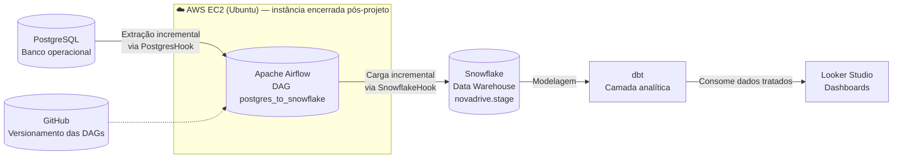
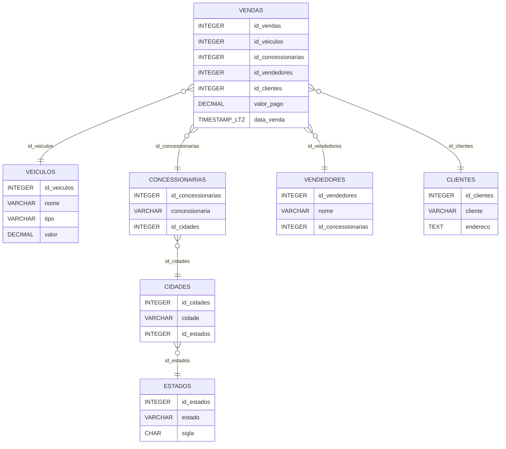

# drive-motors-data-pipeline
Pipeline ETL incremental com Apache Airflow: PostgreSQL → Snowflake, transformação com dbt e dashboards no Looker Studio

# Drive Motors — Pipeline de Dados (PostgreSQL → Snowflake)

[](https://www.python.org/)
[](https://airflow.apache.org/)
[](https://www.snowflake.com/)
[](https://www.getdbt.com/)
[](https://www.postgresql.org/)
[](https://aws.amazon.com/ec2/)

Pipeline de dados que replica de forma **incremental** o banco operacional de uma
concessionária (PostgreSQL) para um Data Warehouse (**Snowflake**), com
orquestração via **Apache Airflow** executado em uma instância **AWS EC2 (Ubuntu)**,
modelagem analítica com **dbt** e visualização no **Looker Studio**.

O cenário simula a operação da empresa fictícia **Drive Motors**, cujo banco
operacional é atualizado constantemente com vendas, veículos, clientes e
concessionárias — exigindo um fluxo de dados robusto para consumo analítico.

---

## 🏗️ Arquitetura



**Fluxo resumido:**

> O Apache Airflow rodou em uma instância **AWS EC2 (Ubuntu)**, orquestrando a
> extração incremental do PostgreSQL e a carga no Snowflake, onde o dbt cria a
> camada analítica consumida pelo Looker Studio. Todo o código é versionado no GitHub.

> 💡 **Nota de infraestrutura:** o Airflow foi provisionado em uma instância
> **EC2 (Ubuntu, Free Tier)** durante o desenvolvimento do projeto. A instância
> foi **encerrada ao final** para evitar custos em nuvem. Para reproduzir o
> ambiente, siga as opções de execução abaixo (local ou nova instância EC2).

---

## 🔁 Fluxo de dados

1. **Coleta** — o banco operacional PostgreSQL é atualizado constantemente com
   transações de vendas, veículos, clientes e concessionárias.
2. **Infraestrutura em nuvem** — instalação e configuração do **Apache Airflow
   em uma instância AWS EC2 com Ubuntu**, responsável por agendar e monitorar
   a execução das tarefas do fluxo.
3. **Orquestração** — a DAG `postgres_to_snowflake` no Airflow executa
   diariamente (`schedule=timedelta(days=1)`, `catchup=False`), construída com
   a **TaskFlow API** (`@dag` / `@task`).
4. **Carga incremental (watermark)** — para cada uma das 7 tabelas, a DAG:
   - consulta o `MAX(ID_{tabela})` já carregado no Snowflake;
   - extrai do PostgreSQL apenas os registros com `ID > max_id`;
   - insere os novos registros no warehouse.
5. **Descoberta dinâmica de esquema** — as colunas de cada tabela são
   identificadas em tempo de execução via `information_schema.columns`,
   sem hardcode.
6. **Transformação** — o dbt cria a camada analítica dentro do Snowflake,
   organizando os dados brutos para consulta.
7. **Visualização** — dashboards no Looker Studio consumindo a camada analítica.
8. **Revisão e melhoria** — avaliação pós-execução do pipeline, com análise de
   alternativas de ferramentas e oportunidades de otimização.

---

## 🗄️ Modelo de dados

Banco `novadrive` (schema `stage`) — mesmo esquema no PostgreSQL (origem) e no
Snowflake (destino). O modelo segue estrutura de **star schema**:

- **Fato:** `vendas` — transações de venda, referenciando as dimensões por
  chaves estrangeiras, com `valor_pago` e `data_venda`.
- **Dimensões:** `veiculos`, `estados`, `cidades`, `concessionarias`,
  `vendedores`, `clientes`.
- Todas as tabelas possuem `data_inclusao` e `data_atualizacao`.



---

## 🧰 Stack

| Camada | Tecnologia |
|---|---|
| Infraestrutura | AWS EC2 (Ubuntu, Free Tier) — instância encerrada pós-projeto |
| Banco operacional | PostgreSQL |
| Orquestração | Apache Airflow (TaskFlow API, Hooks oficiais) |
| Data Warehouse | Snowflake (`database novadrive`, `schema stage`, `warehouse DEFAULT_WH`) |
| Transformação | dbt |
| Visualização | Looker Studio |
| Versionamento | Git / GitHub |

---

## 📁 Estrutura do repositório

```
.
├── dags/
│   └── postgres_to_snowflake.py   # DAG principal (ETL incremental)
├── dbt/                           # Modelos da camada analítica
├── .env.example                   # Variáveis de ambiente de exemplo
└── README.md
```

---

## ⚙️ Como executar

A instância EC2 original foi encerrada após a execução do projeto. Para
reproduzir o ambiente:

**Opção A — Local (recomendada para testes):**

```bash
# 1. Clone o repositório
git clone https://github.com/vitordavips/drive-motors-data-pipeline.git
cd drive-motors-data-pipeline

# 2. Configure as variáveis de ambiente
cp .env.example .env

# 3. Suba o Airflow
docker-compose up -d   # ou sua instalação local

# 4. Ative a DAG `postgres_to_snowflake` na UI do Airflow

# 5. Rode os modelos dbt apontando para o Snowflake
dbt run
```

**Opção B — Nova instância AWS EC2 (como no projeto original):**

1. Provisione uma instância **Ubuntu** (Free Tier `t2.micro`/`t3.micro`);
2. Instale Python, Airflow e as providers `postgres` e `snowflake`;
3. Configure o security group liberando a porta do Airflow UI
   **apenas para o seu IP**;
4. Cadastre as conexões `postgres_conn_id` e `snowflake_conn_id`
   (account, warehouse `DEFAULT_WH`, database `novadrive`, schema `stage`).

No Airflow, cadastre as conexões:

- `postgres_conn_id` → conexão com o PostgreSQL de origem
- `snowflake_conn_id` → conexão com o Snowflake (account, warehouse `DEFAULT_WH`,
  database `novadrive`, schema `stage`)

> ⚠️ **Segurança:** nunca suba credenciais reais. Use sempre `.env` (ignorado
> pelo Git) e cadastre as conexões diretamente na UI/secret backend do Airflow.
> No EC2, restrinja o acesso ao Airflow UI no security group.

---

## 🚀 Melhorias futuras

- **Carga em lote:** substituir o INSERT linha a linha por chunks de
  `INSERT ... VALUES (...)` ou `COPY INTO` para melhorar performance em
  volumes maiores.
- **CDC por timestamp:** usar `MAX(data_atualizacao)` como watermark em vez de
  `MAX(ID)`, capturando também atualizações em registros já carregados.
- **Resiliência:** adicionar `retries > 0` e alertas de falha (Slack/e-mail) nas tasks.
- **Qualidade de dados:** implementar dbt tests e validações pós-carga.
- **Infraestrutura:** migrar o orquestrador para serviço gerenciado (MWAA) ou
  instância com mais memória — o Free Tier (1 GB RAM) limita a performance do Airflow.

---

## 👤 Autor

**Vitor Davi Pereira Soares**

[](https://www.linkedin.com/in/vitor-davi-0240b4246/)
[](https://github.com/vitordavips)